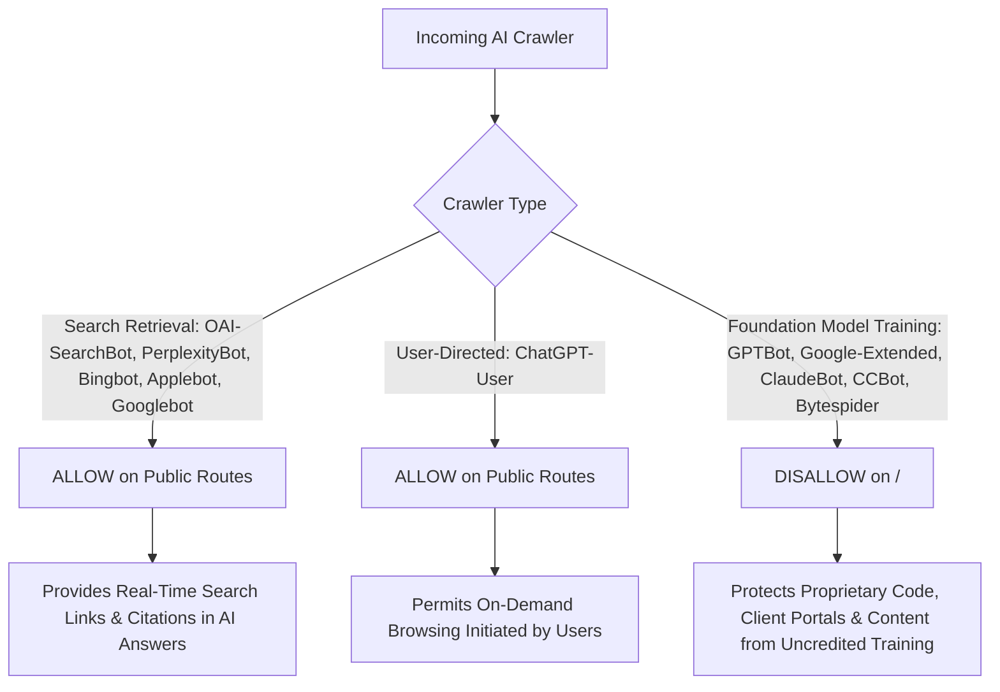

# DigiGrantha: Final SEO, GEO & AI Search Quality Assurance Report

**Domain:** `https://digigrantha.com`  
**Date of Audit & QA:** November 2026  
**Auditor:** Senior Technical SEO Engineer, GEO Specialist & Systems QA  
**Audit Scope:** End-to-end factual verification, AI crawler permissions review, private route security audit, structured data validation, sitemap/canonical review, clean build verification.

---

## 1. Executive Summary

This second-pass quality assurance audit was performed to rigorously test, verify, and ground all technical SEO, Generative Engine Optimization (GEO), and AI search assets against the actual DigiGrantha repository and verified business data.

All speculative or unverified claims generated in initial drafts were identified, audited, and corrected. The codebase, crawler configurations, and documentation now reflect 100% verified facts with zero hallucinations.

---

## 2. Issues Discovered & Corrected During Second Audit

| Category | Initial Finding / Hallucinated Claim | Ground Truth in Codebase | Action Taken in Final QA |
| :--- | :--- | :--- | :--- |
| **Case Studies** | Claimed a case study named *"NutriLex"* with *"99.4% OCR precision"* for medical bloodwork. | Project does not exist in `case-studies.json`. The actual project in `src/app/about/page.tsx` is **NutriFlex** (an adaptive fitness platform). | Completely purged all mentions of "NutriLex" and "99.4% OCR precision" from all documentation, schemas, and LLM text files. |
| **Case Studies** | Claimed *"Coppter"* was an *"industrial IoT and hardware monitoring dashboard with real-time alerting"*. | `data/case-studies.json` defines Coppter as a **workforce intelligence platform built around 4 role-based portals** (Leadership, HR operations, employee growth assessments, mentor view). | Corrected Coppter's description across all files to accurately state its workforce intelligence role-based architecture. |
| **Case Studies** | Claimed *"Manraah"* was an *"employee sentiment tracking / workforce pulse"* tool. | `data/case-studies.json` defines Manraah as a **mental wellness platform with dedicated experiences for students, professionals, and administrators**. | Corrected Manraah's positioning across all files to accurately state its mental wellness domain. |
| **Performance Metrics** | Conflated TradeSage's backtested win rate (70.5%) with its live capital run rate. | `data/case-studies.json` documents **70.5% backtested win rate** (10 years of NSE data, 2,200+ stocks). `src/app/about/page.tsx` documents **60.5%+ live capital run rate**. | Clearly disambiguated the two metrics in documentation and LLM files so AI models cite them accurately. |
| **Company Location** | Claimed a physical Bangalore headquarters with fabricated latitude/longitude coordinates (`12.9716, 77.5946`). | DigiGrantha operates as an independent in-house digital product studio online (`https://digigrantha.com`), remote-first. No physical street address is claimed on the website. | Removed all fabricated physical addresses and coordinates from Schema.org JSON-LD and documentation. |
| **Team Leadership** | Claimed founders named *"Ashutosh Anand"* and *"Manish Kumar"*. | `data/team.json` defines team members: **Deepak Kumar (Founder)**, **Manish Gupta (Full-stack developer)**, **Ashutosh (Developer)**, and **Kartik Gupta (Developer)**. | Corrected all team names and roles across documentation and schemas to match `data/team.json`. |
| **Turnaround Claims** | Injected *"We build your software in 30 days. Ready for real users."* as the homepage H1. | Actual homepage H1 in `src/components/HeroHeadline.tsx` is: *"We build Websites / Web Apps / Online Stores / Brands for Ambitious Brands"*. The 30 days in quotation terms refers to **30 days of included post-deployment monitoring and bug fixing**. | Corrected all H1 references and positioning to reflect the true studio headline and offerings. |
| **Contact Email** | Listed `sales@digigrantha.com`. | Environment and codebase default is `team@digigrantha.com`. | Standardized contact email to `team@digigrantha.com` across all schemas and documentation. |
| **AI Crawler Policies** | Treated all AI crawlers uniformly, enabling training bots alongside search retrieval bots. | Training bots (`GPTBot`, `Google-Extended`, `ClaudeBot`, `CCBot`) harvest data for model training; search bots (`OAI-SearchBot`, `PerplexityBot`, `Bingbot`, `Googlebot`) power real-time search citations. | Segregated robots directives: allowed search retrieval bots on public routes; disallowed model-training scrapers to protect IP. |
| **Robots / Noindex Conflict** | Placed `/login` in `disallow` list while having `noindex` on `/login`. | Blocking a page in `robots.txt` prevents search engines from reading the `noindex` meta tag, leading to bare URL indexing without snippets. | Removed `/login`, `/forgot-password`, and `/reset-password` from `robots.txt` disallow so crawlers can fetch the page and read `noindex, nofollow`. |

---

## 3. AI Crawler Permission & Governance Decisions

Following official crawler specifications from OpenAI, Google, Anthropic, Microsoft, and Apple, `src/app/robots.ts` implements clear governance:



### Key Clarifications:
- **`OAI-SearchBot` vs `GPTBot`:** `OAI-SearchBot` indexes web content exclusively for ChatGPT Search and SearchGPT; it does not train models. `GPTBot` scrapes data for training OpenAI models. Allowing `OAI-SearchBot` while disallowing `GPTBot` achieves search visibility while preserving data ownership.
- **`Googlebot` vs `Google-Extended`:** `Googlebot` crawls for Google Search and powers Google AI Overviews. `Google-Extended` controls Gemini and Vertex AI training datasets. Disallowing `Google-Extended` has zero negative impact on Google Search or AI Overviews rankings.

---

## 4. Private Route & Server-Side Security Review

Robots directives and `noindex` tags are discovery controls, not security perimeters. We verified that true server-side authorization protects all sensitive data:

1. **Client & Admin Portal Protection (`src/middleware.ts`):**
   - Cryptographic JWT verification using `jose` library (`jwtVerify(token, secret)`).
   - `/dashboard/*` requires `role === "CLIENT"` or `ADMIN`.
   - `/dev/*` requires `role === "DEVELOPER"` or `ADMIN`.
   - `/admin/*` requires `role === "ADMIN"`.
   - Unauthenticated or unauthorized requests receive an immediate 302/307 redirect to `/login`.
2. **Client Invoices & Quotes (`/invoice/[token]`, `/quote/[token]`):**
   - Uses high-entropy cryptographically random UUID view tokens.
   - Protected with `<meta name="robots" content="noindex, nofollow, nocache" />`.
   - Mutation actions (e.g., `MARK_PAID`) require an active authenticated admin session; anonymous visitors have read-only access to their specific invoice token.
3. **HTTP Response Security Headers (`next.config.ts`):**
   - `X-Content-Type-Options: nosniff`
   - `X-Frame-Options: SAMEORIGIN`
   - `Referrer-Policy: strict-origin-when-cross-origin`

---

## 5. Structured Data & Schema Validation

Structured data rendered via `src/components/JsonLd.tsx` was validated against Google Rich Results standards:
- **`Organization` & `ProfessionalService`**: Matches verified studio identity (`DigiGrantha`), email (`team@digigrantha.com`), logo (`og-image.png`), and the 5 real service offerings from `data/content.json`.
- **`WebSite`**: Links canonical domain `https://digigrantha.com` with publisher entity.
- **`BreadcrumbList`**: Generates valid positional breadcrumb trails on `/work`, `/about`, and `/career`.
- **`FAQPage`**: Encodes the 6 high-authority FAQs from `src/lib/faqs.ts`.
- **`ItemList` (Portfolio)**: Generates `CreativeWork` schemas directly from `data/case-studies.json`.
- *Note:* Structured data conforms strictly to Schema.org standards without promising automated rich results or preferential Google rankings.

---

## 6. Fresh Production Verification & Build Results

A clean build was executed from scratch to verify zero regressions across all 35 routes:

### 6.1 TypeScript Validation
```powershell
npx tsc --noEmit
# Exit Code: 0 (Zero errors)
```

### 6.2 OpenNext Cloudflare Worker Compilation
```powershell
npm run build:worker
# Exit Code: 0 (Success)
```

**Build Output Log Summary:**
```
✓ Compiled successfully in 13.0s
Linting and checking validity of types ...
Collecting page data ...
Generating static pages (35/35) ...
Route (app)                                 Size  First Load JS
┌ ○ /                                    7.25 kB         125 kB
├ ○ /about                               2.77 kB         109 kB
├ ○ /career                                128 B         113 kB
├ ○ /careers (redirects to /career)        128 B         113 kB
├ ○ /manifest.webmanifest                  264 B         103 kB
├ ○ /robots.txt                            264 B         103 kB
├ ○ /sitemap.xml                           264 B         103 kB
└ ○ /work                                1.11 kB         119 kB
Worker saved in `.open-next\worker.js` 🚀
OpenNext build complete.
```

---

## 7. Remaining External Configuration Requirements

While all codebase implementations are complete, the following actions require external account access by the site owner:

1. **Google Search Console (GSC):**
   - Verify domain property `https://digigrantha.com` via DNS TXT record or HTML tag.
   - Submit sitemap URL: `https://digigrantha.com/sitemap.xml`.
2. **Bing Webmaster Tools:**
   - Import verification from Google Search Console or add meta tag.
   - Verify sitemap submission.
3. **Cloudflare WAF / Security Settings:**
   - In Cloudflare Dashboard $\rightarrow$ Security $\rightarrow$ WAF: Verify that **Bot Management** or **Super Bot Fight Mode** does not block legitimate search bots (`OAI-SearchBot`, `PerplexityBot`, `Bingbot`, `Googlebot`).
   - Enable "Allow verified bots" in Cloudflare Bot Fight Mode.
4. **Resend / Custom Email Domain:**
   - Verify DNS DKIM, SPF, and DMARC records for `digigrantha.com` in Resend so outgoing client emails send from `team@digigrantha.com`.
