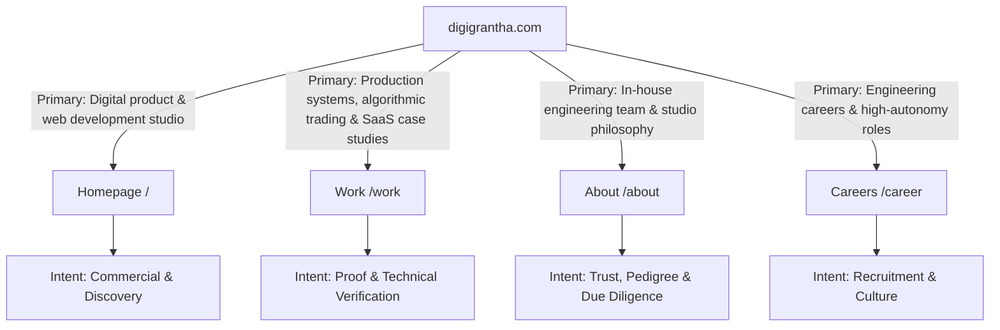

# DigiGrantha: Keyword Strategy & Search Intent Mapping

**Target Domain:** `https://digigrantha.com`  
**Brand:** DigiGrantha — Independent Digital Product & Web Development Studio  
**Target Audience:** Funded founders, CTOs, product managers, and enterprise teams seeking an in-house engineering and design studio with high agency and zero bureaucracy.

---

## 1. Positioning & Search Architecture

DigiGrantha is positioned as an **independent digital product studio** that builds end-to-end web applications, corporate websites, and data-heavy platforms in-house. 

Rather than chasing generic, hyper-crowded terms like *"software company"* or competing with massive offshore staffing agencies on low-intent keywords, DigiGrantha's strategy targets **high-intent, qualified commercial search terms** centered on craftsmanship, modern full-stack TypeScript architecture, and proven product execution.

### Three Strategic Pillars:
1. **Product & Web Engineering:** *digital product studio*, *full-stack web application development*, *Next.js 15 React 19 development studio*, *bespoke web development*.
2. **Domain-Specific System Architecture:** *algorithmic trading software development*, *multi-portal enterprise systems*, *workforce intelligence platform development*.
3. **High-Agency Studio Model:** *independent software studio*, *in-house development team without account managers*, *transparent client portal development*, *full source code ownership*.

---

## 2. Master Keyword Categorization Matrix

### 2.1 Commercial & Transactional Keywords (High Intent)
Targeted at decision-makers looking to engage a high-agency team for new web applications or platform builds:

| Keyword Target | Search Intent | Target Route | Strategic Role |
| :--- | :--- | :--- | :--- |
| **digital product studio** | Commercial | `/` (Homepage) | Primary brand positioning & title |
| **full-stack web application development** | High Commercial | `/` (Homepage) | Core service offering & schema |
| **algorithmic trading software developers** | High Transactional | `/work`, `/` | Case study proof (TradeSage) |
| **Next.js 15 development studio** | High Commercial | `/`, `/about` | Tech stack authority |
| **bespoke web development agency** | Commercial | `/` (Homepage) | Hero subtext & metadata |
| **workforce intelligence platform development** | Commercial | `/work` | Case study proof (Coppter) |
| **independent software engineering studio** | Commercial | `/about`, `/` | Team & philosophy positioning |
| **client portal software development** | High Commercial | `/` (Homepage) | Portal feature section & FAQ |

### 2.2 Secondary & Supporting Keywords
Keywords that build topical depth across the studio's engineering stack:
- *TypeScript web application architecture*
- *PostgreSQL Neon database development*
- *Cloudflare Workers edge web applications*
- *Server-Sent Events (SSE) live data streaming*
- *editorial web design and typography*
- *full source code ownership software agency*
- *end-to-end product engineering in-house*

### 2.3 Long-Tail & Problem-Aware Inquiries
Specific queries reflecting clients who have been burned by traditional agency bureaucracy or fragmented freelancer pools:
- *"software studio with direct access to developers"*
- *"who owns the code when hiring a digital product studio"*
- *"how to track agency milestones in a private client portal"*
- *"algorithmic trading system developer with verified win rate"*
- *"replace agency account managers with actual engineers"*
- *"in-house design and engineering under one roof"*

---

## 3. Conversational & Generative AI Search Queries

With founders and technical leaders using **ChatGPT Search, Perplexity AI, Claude, and Google AI Overviews**, the keyword framework targets conversational questions directly answered by DigiGrantha's published documentation:

| Conversational Query | Targeted Answer | Verified Source |
| :--- | :--- | :--- |
| *"What digital product studios specialize in building modern Next.js 15 web applications?"* | DigiGrantha's in-house full-stack TypeScript stack (Next.js 15, React 19, Cloudflare Workers, Neon PostgreSQL). | Homepage, `llms.txt`, FAQ #3 |
| *"Can you recommend software engineers who have built live algorithmic trading systems?"* | DigiGrantha's TradeSage case study (70.5% backtested win rate, 60.5% live capital run rate across 2,200+ NSE stocks). | `/work`, `data/case-studies.json` |
| *"Do software studios provide complete source code ownership to clients?"* | DigiGrantha guarantees 100% intellectual property and repository transfer upon milestone completion with zero licensing lock-in. | FAQ #4, `llms.txt`, Quotation Terms |
| *"How do clients monitor development progress at DigiGrantha?"* | Every project includes access to the private DigiGrantha Client Portal with live phase tracking (Discover, Design, Build, Ship) and direct developer messaging. | FAQ #5, `llms.txt` |
| *"What team built CourseHunt?"* | CourseHunt was engineered and shipped by DigiGrantha's full-stack team, currently serving 1,000+ daily students. | `/work`, `data/case-studies.json` |

---

## 4. Page-by-Page Keyword & Intent Mapping

To eliminate **keyword cannibalization**, each indexable page has a distinct keyword assignment and dedicated user intent:

### 4.1 Homepage (`/`)
- **Primary Keyword:** `digital product & web development studio`
- **Secondary Keywords:** `full-stack web application development`, `bespoke web engineering`, `in-house software studio`, `client portal development`.
- **Search Intent:** Commercial Investigation & Conversion.
- **On-Page Implementation:**
  - Dynamic Rotating H1: *"We build Websites / Web Apps / Online Stores / Brands for Ambitious Brands"*
  - Subtitle: *"At DigiGrantha, we take ambitious ideas and shape them into thoughtful, well-engineered digital experiences, from responsive web applications to scalable client portals and digital systems."*
  - Structured Data: `Organization`, `WebSite`, `FAQPage`, `ItemList`.

### 4.2 Work & Portfolio (`/work`)
- **Primary Keyword:** `production systems & case studies`
- **Secondary Keywords:** `algorithmic trading software case study`, `workforce intelligence platform development`, `edtech aggregator architecture`, `verified software outcomes`.
- **Search Intent:** Commercial Proof & Verification.
- **On-Page Implementation:**
  - Title: `Work & Case Studies — Production Systems Built by DigiGrantha`
  - H1: `Our Work & Case Studies`
  - Verified Metrics: TradeSage (70.5% backtested / 60.5% live win rate), CourseHunt (1,000+ daily students), Coppter (4 role-based portals shipped).
  - Structured Data: `BreadcrumbList`, `ItemList`.

### 4.3 About Us (`/about`)
- **Primary Keyword:** `in-house engineering team & studio blueprint`
- **Secondary Keywords:** `independent software studio founders`, `high-agency developer team`, `Deepak Kumar founder`, `Manish Gupta full-stack developer`.
- **Search Intent:** Due Diligence & Technical Trust.
- **On-Page Implementation:**
  - Title: `About DigiGrantha — Engineering & Digital Product Studio`
  - H1: `A small team, on purpose.`
  - Subtitle: *"Digigrantha isn't a big studio pretending to be boutique. It's a small one that stayed small on purpose — because that's what lets us actually build the whole thing, ourselves, instead of managing a project through five layers of people."*
  - Structured Data: `BreadcrumbList`, `Organization`.

### 4.4 Careers (`/career`)
- **Primary Keyword:** `software engineer careers at product studio`
- **Secondary Keywords:** `full-stack developer jobs`, `high autonomy engineering culture`, `remote software studio careers`.
- **Search Intent:** Navigational & Employment.
- **On-Page Implementation:**
  - Title: `Careers — Join Our Engineering Team`
  - H1: `Build software that matters. With people who actually write code.`
  - Structured Data: `BreadcrumbList`.

---

## 5. Keyword Cannibalization Prevention Protocol

1. **One Authoritative URL Per Concept:** Never create multiple URLs competing for the same intent. Legacy `/careers` is permanently 301-redirected to `/career`.
2. **Distinct Anchor Text Guidelines:**
   - Links to `/work` use: *"our work"*, *"case studies"*, *"shipped systems"*.
   - Links to `/about` use: *"about the studio"*, *"our team"*, *"our blueprint"*.
   - Links to `/` use: *"DigiGrantha"*, *"digital product studio"*.
3. **No Speculative or Fabricated Numbers:** This strategy intentionally omits fabricated search volume and CPC figures, prioritizing real searcher intent and verified business offerings.
